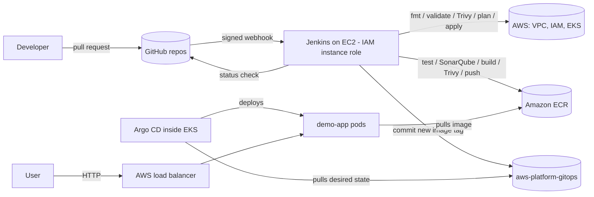

# aws-platform-infra

Multi-environment AWS platform (dev/stage/prod) built with Terraform modules,
remote state, Jenkins CI/CD, Trivy, SonarQube and Argo CD.

# Multi-Environment AWS Platform with Terraform, Jenkins and GitOps

Reusable Terraform modules build identical **dev / stage / prod** EKS environments on AWS.
Every infrastructure change goes through a **pull request with format checks, validation,
a Trivy security gate and a plan**; merging applies dev automatically and promotes to
stage/prod only after **manual approval**. Applications are delivered via **GitOps**:
Jenkins builds, scans and pushes images, then commits the new version to a GitOps repo
that **Argo CD** syncs into the cluster. **No static AWS access keys exist anywhere.**


## Architecture



## Repositories

| Repo | Purpose |
|---|---|
| `aws-platform-infra` (this) | Terraform modules, environments, infra pipeline |
| `demo-app` | FastAPI service + app pipeline (tests, SonarQube, Trivy, ECR, GitOps update) |
| `aws-platform-gitops` | Desired state of the cluster (Argo CD Applications + Kubernetes manifests) |

## Repository layout

```
bootstrap/   S3 state bucket (versioned, KMS, private, prevent_destroy) + DynamoDB lock table
global/      shared, long-lived: ECR, tools VPC (no NAT), Jenkins + SonarQube server, jenkins-role
modules/     vpc · iam · ecr · eks · argocd · jenkins   (reusable building blocks)
envs/        dev · stage · prod  → identical main.tf; only terraform.tfvars + backend key differ
Jenkinsfile               PR: checks + plan | main: apply dev → approve → stage → approve → prod
Jenkinsfile.drift         nightly terraform plan -detailed-exitcode → GitHub issue on drift
Jenkinsfile.dev-destroy   nightly: remove K8s load balancers via Argo CD, then destroy dev
.trivyignore              accepted security findings, each with a reason and an expiry date
```

## How it works

**Infrastructure change:** branch → PR → Jenkins runs `fmt`, `validate`, Trivy (gate) and
`plan` for all environments → a GitHub ruleset blocks merging unless the check passes →
merge → Jenkins applies dev automatically → stage and prod each require a manual approval
and apply **exactly the reviewed saved plan**.

**Application release:** PR in `demo-app` → tests, SonarQube quality gate, Docker build,
Trivy image gate → merge → image pushed to ECR tagged with the git commit → Jenkins commits
`newTag` to the GitOps repo → Argo CD performs a rolling update. Jenkins has **no
Kubernetes credentials**; rollback is a `git revert`.

**Nightly:** drift detection compares real AWS with `main`; dev is destroyed to save cost.

## Security

| Layer | Control |
|---|---|
| Identity | IAM Identity Center for humans, EC2 instance role for Jenkins; no access keys |
| Network | EKS API restricted to the Jenkins EIP + admin IP; nodes in private subnets |
| Kubernetes | Explicit EKS access entries (cluster-admin only for the SSO role and jenkins-role) |
| Prevention | Trivy config gate (infra) and image gate (app), SonarQube quality gate, required PR checks |
| Detection | EKS audit logs (7-day retention), nightly drift detection |
| Integrity | Immutable ECR tags, HMAC-signed webhooks, IMDSv2, encrypted EBS and state |

**Trivy triage** (fixed or consciously accepted, see `.trivyignore`):

| Finding | Decision | Reason |
|---|---|---|
| AWS-0041 EKS API open to 0.0.0.0/0 | **Fixed** (2 × /32); residual finding documented | Scanner flags any public CIDR; full fix needs VPN |
| AWS-0040 EKS public endpoint | Accepted | No VPN/peering; restricted + IAM-authenticated |
| AWS-0039 No KMS envelope encryption for Secrets | Accepted | Nightly rebuild → KMS key churn; enable in prod |
| AWS-0104 Jenkins egress 0.0.0.0/0 | Accepted | Builds need package repos/GitHub/AWS; inbound restricted |
| AWS-0132 State bucket uses AWS-managed KMS key | Accepted | Encrypted, private, versioned; CMK for prod |

## Design decisions

- **Folder per environment** instead of workspaces: explicit, separate state per env, no "wrong workspace" applies.
- **Same `main.tf` in every env**, differences only in `terraform.tfvars`: environments can't drift apart structurally.
- **Separate GitOps repo**: Jenkins never touches the cluster; avoids CI loops; Git is the deployment audit log.
- **Argo CD bootstrapped by Terraform** (Helm): every rebuild of dev restores Argo CD *and* the apps automatically.
- **Saved plan files** for stage/prod: what was approved is exactly what is applied.
- **ClusterIP first, LoadBalancer after a safe destroy existed**: Kubernetes-created AWS resources are deleted through Argo CD before `terraform destroy`.

## Known limitations / next steps

- Jenkins role has AdministratorAccess → split into a read-only plan role and per-env apply roles.
- Builds run on the Jenkins controller → separate agents (or ephemeral Kubernetes agents).
- Jenkins configuration is manual → Jenkins Configuration as Code (JCasC).
- Public EKS endpoint → private endpoint + VPN / VPC peering.
- Admin IP lives in tfvars → central allow-list (SSM Parameter Store).
- Cost per environment → `Environment` default tag + cost allocation tags.

## Run it

See [`docs/RUNBOOK.md`](docs/RUNBOOK.md).

## Screenshots

| | |
|---|---|
|  |  |
|  |  |
|  |  |
